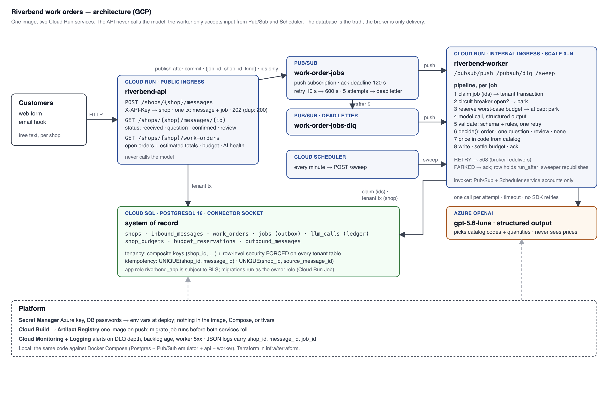

# Architecture note

Riverbend work orders turns free-text customer messages into priced, structured work orders for
three bike shops that must never see each other's data. Decision records with alternatives are
in `decisions.md`.

## Shape

Two processes from one image: the API never calls the model; the worker accepts input only from
Pub/Sub and Scheduler.

## Module boundaries

| Module | Owns | Must not |
|---|---|---|
| `api/` | HTTP contract; tenant from the API key | touch the model; trust the body for identity |
| `ingest.py` | the accept transaction (message + outbox job); publish after commit | block on the broker |
| `dispatch.py` | moving a job id to the worker (Pub/Sub, inline, doubles) | carry customer text |
| `worker/pipeline.py` | the stages above; retry and park policy | compute a price or a date |
| `extraction/` | prompt, model schema, validation rules, provider interface (Azure, fake) | decide policy |
| `decide.py`, `pricing.py`, `dates.py` | pure: ask-or-order policy, arithmetic, date resolution | call anything |
| `repo/` | SQL per table; tenant tables reachable only inside `tenant_tx` | cross-table policy |

The line that matters most: **the model proposes, code disposes.** The model returns catalog
codes, quantities, a classified date phrase, and a proposed outcome. Everything that costs money
or changes state is computed or decided by tested code.

## Data model

`shops` (id, api_key_hash, timezone, monthly_cap_micros) is the tenant; every other table starts
with `shop_id`. `inbound_messages` is unique on `(shop_id, message_id)`, the idempotency key the
sender controls. `work_orders` is unique on `(shop_id, source_message_id)`, so a job that runs
twice is a no-op. Foreign keys are composite, so an order in one shop cannot reference a message
in another even by accident. `jobs` is the outbox and the processing record (status, attempts,
run_after, park_reason) and holds ids only. `llm_calls` is the ledger: tokens, cost from a config
price table, latency, outcome, validation errors, raw output. `shop_budgets` holds spent and
reserved per month.

A work order moves `processing → open | awaiting_customer | needs_review`, then
`awaiting_customer → (reply) → open | needs_review`, or `→ expired` after seven days. Output that
fails validation never becomes a row; the failure is recorded on the message.

## Tenancy

Three layers, each catching a different mistake. (1) The API key resolves the shop and must
match the path; a valid key on another shop's path is a 404, so shops cannot be enumerated.
(2) Composite keys make cross-shop references unrepresentable. (3) Row-level security is
enabled and *forced* on every tenant table, keyed on a transaction-local setting. A handler
that forgets its WHERE clause gets only its own rows; a path that forgets to set the tenant gets
zero rows and can write none. The worker claims the job across shops (ids only), then opens a
tenant transaction for everything else, so even the prompt builder cannot read another shop's
text. Tests prove each layer at the SQL and HTTP level.

## Failure handling

**Duplicates.** The second arrival hits the unique constraint and returns the existing status
with a 200; concurrent duplicates are resolved by the database. A redelivered job finds the
order exists and acks without a second model call.

**Provider slow or down.** SDK retries are off. A timeout or 5xx returns 503 and Pub/Sub
redelivers with backoff, five times, then dead-letters into a failed outcome. Three consecutive
failures open a breaker; while open, jobs are parked with a run-after instead of burning
attempts, and the sweeper republishes them. The customer sees "received, confirming shortly"
throughout; the shop sees `ai.degraded`, the number waiting, and the number parked.

**Spend cap.** One conditional UPDATE reserves the worst case (two calls at max output) against
the shop's month before each call and settles to actual after. At the cap the job parks until
next month or until the cap is raised; the cap is read from `shops` on every reservation so a
raise applies at once. The customer sees "received"; the shop sees `budget.exhausted`. Every
call, including failed ones, is in the ledger, which is where the results table's spend comes
from.

## Three decisions to challenge

1. **Pub/Sub for delivery, Postgres outbox as the truth.** The assistant proposed a
   Postgres-only SKIP LOCKED queue; I overrode it (`ai-decisions-log.md`). I kept the outbox
   because the dual-write problem is real, and added the broker for push delivery, backlog
   scaling, and dead-lettering. The cost is a third system locally and job state in two places:
   Pub/Sub for normal retries, the row for parked states. Is that split clearer or murkier than
   one mechanism?

2. **No agent framework: a flat structured-output schema plus a pure `decide()`.** The
   one-question rule is an integer on the row, not a prompt instruction; history on resume is
   three stored rows replayed as chat turns. At what point does this stop being enough? My
   answer is when the conversation becomes open-ended and tool-driven. Someone may think that
   point is closer than I do.

3. **Row-level security in one shared schema rather than schema-per-shop.** Tenant scoping
   becomes a database guarantee rather than a code convention, at almost no cost at this size.
   But the worker and sweeper run under one role and switch tenants per transaction. A reviewer
   may prefer a role per shop or per-shop schemas for auditability at 100 shops.
